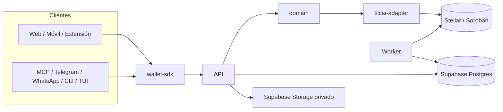

# TilcAI Wallet

> **Tarjetas de gasto para agentes de IA.** Fondeas una sesión, el agente compra dentro de los límites, tú controlas todo desde el celular y cada compra deja un recibo verificable en Stellar.

[Landing](https://tilcai-wallet.vercel.app/) · [PWA](https://tilcai-wallet-pwa.vercel.app/) · [Contrato en Testnet](https://lab.stellar.org/r/testnet/contract/CDCSGJZCHL5SOYURXLZ6YZQGWIOFN3FDREKJ27LGPPPCFJRIPPLIVLT6) · [Pago de 0,50 USDC](https://stellar.expert/explorer/testnet/tx/0f624b09c43169743b81deacf956f3415dc5feef87ddb61fdd52f676a76143d8)

**Para quién:** agencias de automatización con IA en La Paz, Bolivia, y freelancers que operan agentes para clientes. **Precio previsto:** primera tarjeta gratis y US$4 al mes por cada tarjeta activa adicional. [Mercado y precio](#mercado-y-precio)

**Estado:** el límite de gasto funciona en Stellar Testnet: un contrato Soroban confirmó un pago de 0,50 USDC y rechaza el siguiente por tope. La PWA y el servidor MCP están publicados con datos simulados. La compra integrada (API, worker y Postgres) está en desarrollo. [Qué funciona hoy](#qué-funciona-hoy) · [Prioridades](docs/roadmap.md)

**Almacenamiento elegido:** Supabase Postgres para sesiones, órdenes, intentos y recibos. Supabase Storage privado para los archivos que custodie la wallet. Stellar confirma saldos, gastos y políticas. La integración está pendiente. [Decisión y alcance](docs/adr/003-supabase-persistence.md)

---

## Qué funciona hoy

| Pieza | Estado | Evidencia o detalle |
| --- | --- | --- |
| Contrato de política Soroban v1 | **Stellar Testnet** | Limita activo, destinatario, monto por pago y gasto acumulado, y permite congelar. Desplegado en [`CDCSGJZC…PLIVLT6`](https://lab.stellar.org/r/testnet/contract/CDCSGJZCHL5SOYURXLZ6YZQGWIOFN3FDREKJ27LGPPPCFJRIPPLIVLT6). Pago y rechazo en [Evidencia en Testnet](#evidencia-en-testnet). |
| Contrato v2: pago atado a destinatario y revisión de política | **Código y pruebas** | Fusionado en [#15](https://github.com/TilcAI-Wallet/tilcai-wallet/pull/15). Falta desplegar una instancia nueva. |
| PWA · passkey | **Real en el dispositivo** | WebAuthn del navegador (Windows Hello, Touch ID, huella). El servidor todavía no verifica la firma. |
| PWA · saldo, tarjeta, actividad, agentes, sesiones, avisos y congelación | **Simulado** | Datos de demostración guardados por la propia PWA. No consultan la red ni la API. |
| PWA · recibo | **Mixto** | El hash y el ledger son los del pago real en Testnet. La orden y la entrega son simuladas. |
| PWA · conexión MCP (`get_wallet_status`, `request_purchase`, `list_receipts`) | **Conexión real, compras simuladas** | Un cliente MCP se conecta de verdad con un código de un solo uso. Las compras no mueven fondos. [Detalle](apps/web/README.md#conectar-un-agente-de-verdad-mcp) |
| MCP stdio (`get_card`, `create_order`, `get_order`, `get_receipt`) | **Probado con fixtures** | Usa la API v1 y su contrato de esquemas. La API real llega con [#12](https://github.com/TilcAI-Wallet/tilcai-wallet/pull/12). |
| API v1, worker y Postgres | **En desarrollo** | [#12](https://github.com/TilcAI-Wallet/tilcai-wallet/pull/12): migraciones, RLS, idempotencia y worker. |
| Aumento de tope aprobado con passkey y aplicado en la red | **Diseño** | Flujo definido en [Arquitectura](docs/architecture.md). Hoy la aprobación cambia solo el estado simulado. |
| Evidencia de entrega del proveedor | **Diseño** | Proveedor de prueba descrito en [API v1 y entorno](docs/demo-api.md). |
| Landing | **Publicada** | Recorrido ilustrativo de una compra. |
| Extensión, Telegram, WhatsApp, CLI, TUI y app nativa | **Base** | Puntos de entrada que compilan, sin conexión a la API. |

### Evidencia en Testnet

| Qué | Dónde |
| --- | --- |
| Despliegue del contrato, ledger 5859014 | [Transacción](https://stellar.expert/explorer/testnet/tx/946742e70ee59e81f3267b725c11a0da16f04f183deaa706703eeef848595b16) |
| Fondeo de 20 USDC de prueba | [Transacción](https://stellar.expert/explorer/testnet/tx/1437898559b9749b77ad2152db62eea2b09065255a7b0e68105d80870f38ed82) |
| Pago de 0,50 USDC dentro del tope, ledger 5859035 | [Transacción](https://stellar.expert/explorer/testnet/tx/0f624b09c43169743b81deacf956f3415dc5feef87ddb61fdd52f676a76143d8) |
| Rechazo de un pago que supera el tope | Simulación pública: `spend(1)` devuelve `Error(Contract, #2)` (`LimitExceeded`). Verificado el 22 de noviembre de 2026 en el ledger 5867860. |

El rechazo no envía una transacción: Soroban lo detiene en la simulación, antes de cobrar comisión. Cualquiera puede repetirlo con su propia identidad de Testnet, sin las claves del agente, porque la simulación no exige firmas:

```sh
stellar contract invoke --network testnet --source <tu-identidad> --send no \
  --id CDCSGJZCHL5SOYURXLZ6YZQGWIOFN3FDREKJ27LGPPPCFJRIPPLIVLT6 -- policy
# spent 5000000 = limit 5000000: el tope de 0,50 USDC está agotado
stellar contract invoke --network testnet --source <tu-identidad> --send no \
  --id CDCSGJZCHL5SOYURXLZ6YZQGWIOFN3FDREKJ27LGPPPCFJRIPPLIVLT6 -- spend --amount 1
# Error(Contract, #2): LimitExceeded
```

Esta instancia ejecuta la versión 1 del contrato. [Interfaz y pendientes del contrato](contracts/soroban/README.md)

---

## Mercado y precio

| | |
| --- | --- |
| **Clientes posibles** | Unas 250 agencias y freelancers de automatización con IA en La Paz y unas 800 en Bolivia. |
| **Cómo se calculó** | SEPREC registra 398.131 unidades económicas a noviembre de 2025 y La Paz concentra el 30,9 %. En La Paz eso da unas 5.410 de información y comunicaciones y 10.815 de servicios profesionales y técnicos. Suponemos que un 40 % de las primeras son software y consultoría TI y un 8 % de las segundas son publicidad y marketing: unos 3.000 negocios digitales. Si un 8 % vende automatización con IA y compra datos o APIs para clientes, quedan unas 250. [SEPREC, noviembre de 2025](https://www.seprec.gob.bo/wp-content/uploads/2025/12/Informacion-ESTADISTICA-WEB-NOV_v1.pdf) |
| **Precio previsto** | Primera tarjeta gratis. Cada tarjeta activa adicional cuesta US$4 al mes. Una tarjeta está activa si tuvo saldo o alguna compra en el mes. |
| **Ejemplo** | Una agencia con 4 agentes paga US$12 al mes. Con 250 agencias en La Paz, el techo es de unos US$36.000 al año. |
| **Por validar** | Los dos porcentajes del cálculo, el precio y el número de tarjetas por agencia se confirman en entrevistas con agencias de La Paz. |

---

## Empieza en 3 pasos

Necesitas **Node.js 24.22.1** (ver `.node-version`) y **pnpm 10.33.0**. Para los contratos, también **Rust** y **Stellar CLI**.

```sh
# 1. Instalar todo el workspace
pnpm install --frozen-lockfile

# 2. Comprobar que todo compila y pasa las pruebas
pnpm check

# 3. Levantar la API y la web (cada una en su terminal)
pnpm --filter @tilcai-wallet/api dev     # http://127.0.0.1:4000/healthz
pnpm --filter @tilcai-wallet/web dev     # http://localhost:3000
```

La base actual arranca en local con los valores de ejemplo. La primera compra integrada incorporará Postgres y variables de servicio por entorno. [`.env.example`](.env.example) documenta las variables disponibles hoy.

---

## Cómo encaja todo



**Regla de oro:** los clientes solo hablan con la API a través de `wallet-sdk`. Nunca importan firmantes, credenciales ni acceso directo a datos. Más detalle en [Arquitectura](docs/architecture.md).

### Investigación poscuántica

**En curso.** La primera prueba propuesta usa una tarjeta de agente aislada y un pago de **0,50 USDC de prueba**. El trabajo de contratos y de canales de la primera entrega puede avanzar en paralelo con esta investigación.

| Ruta | Cómo se autoriza la orden de pago |
| --- | --- |
| Wallet Stellar clásica `G…` | Orden → la clave Ed25519 firma la transacción → Stellar verifica y confirma el pago. |
| Tarjeta experimental TilcAI `C…` | Orden → el firmante aislado firma la autorización Soroban con ML-DSA → el relayer firma el envío con Ed25519 → Soroban verifica firma y política → Stellar confirma → TilcAI concilia el recibo. |

El alcance de la prueba es la **autorización de gasto dentro de la subcuenta**. [Diagrama, tarea delegable y evidencia requerida](docs/research/post-quantum.md)

---

## ¿Qué módulo toco?

Todos los comandos se ejecutan **desde la raíz** del repo.

### Clientes (lo que ve el usuario o el agente)

| Módulo | Para qué sirve | Comando | Stack |
| --- | --- | --- | --- |
| [Landing](apps/landing/README.md) | Página pública del proyecto | `pnpm --filter @tilcai-wallet/landing dev` | Next.js 16.4 estático |
| [Web](apps/web/README.md) | Panel del dueño (PWA) | `pnpm --filter @tilcai-wallet/web dev` | Next.js 16.4 + Tailwind 4 |
| [Móvil](apps/mobile/README.md) | App iOS/Android | `pnpm --filter @tilcai-wallet/mobile dev` | Expo 58 + React Native 0.88 |
| [Extensión](apps/extension/README.md) | Wallet en el navegador | `pnpm --filter @tilcai-wallet/extension dev` | WXT + Manifest V3 |
| [MCP](apps/mcp/README.md) | Herramientas para agentes de IA | `pnpm --filter @tilcai-wallet/mcp start` | MCP SDK v2 (stdio) |
| [Bot de Telegram](apps/telegram-bot/README.md) | Avisos y vínculo por chat | `pnpm --filter @tilcai-wallet/telegram-bot check` | grammY |
| [Mini App de Telegram](apps/telegram-miniapp/README.md) | Panel dentro de Telegram | `pnpm --filter @tilcai-wallet/telegram-miniapp dev` | React + Vite |
| [CLI](apps/cli/README.md) | Consultas desde la terminal | `pnpm --filter @tilcai-wallet/cli start --help` | Commander |
| [TUI](apps/tui/README.md) | Vista interactiva en terminal | `pnpm --filter @tilcai-wallet/tui start` | Ink |

### Servicios (backend)

| Módulo | Para qué sirve | Comando | Puerto |
| --- | --- | --- | --- |
| [API](services/api/README.md) | Gateway: sesiones, tarjetas, órdenes | `pnpm --filter @tilcai-wallet/api dev` | 4000 |
| [Worker](services/worker/README.md) | Conciliación con Stellar | `pnpm --filter @tilcai-wallet/worker check` | — |
| [WhatsApp](services/whatsapp/README.md) | Webhooks y avisos | `pnpm --filter @tilcai-wallet/whatsapp dev` | 4001 |

### Paquetes compartidos

| Paquete | Úsalo para |
| --- | --- |
| `packages/api-contracts` | Esquemas Zod de cada endpoint. **Empieza aquí** si agregas una ruta. |
| `packages/wallet-sdk` | Cliente HTTP que usan todos los canales. |
| `packages/domain` | Reglas de negocio y estados (tarjeta, orden). Sin red ni base de datos. |
| `packages/tilcai-adapter` | Puente hacia Stellar y la infraestructura TilcAI. |
| `packages/config` | Nombre, versión, URL local y paleta de colores. |

### Contratos

| Módulo | Comando |
| --- | --- |
| [Soroban](contracts/soroban/README.md) | `cd contracts/soroban && cargo test --workspace --lib --locked` |

---

## Cómo contribuir

1. Elige una tarea de las [prioridades](docs/roadmap.md) o de los [issues](https://github.com/TilcAI-Wallet/tilcai-wallet/issues) y crea una rama desde `main`.
2. Trabaja solo en tu módulo con `pnpm --filter @tilcai-wallet/<módulo> …`.
3. Ejecuta `pnpm check` antes de subir.
4. Abre un PR. CI corre el workspace y los contratos.

¿Cambias un endpoint? Primero `api-contracts`, luego la API, luego el SDK y al final el cliente. Guía completa en [CONTRIBUTING](CONTRIBUTING.md).

---

## Documentación

| Tema | Documento |
| --- | --- |
| Qué resuelve y ejemplo de uso | [Producto](docs/product.md) |
| Orden de trabajo, dependencias y criterios por canal | [Prioridades del equipo](docs/roadmap.md) |
| Capas y límites de cada módulo | [Arquitectura](docs/architecture.md) |
| Versiones y fuentes oficiales | [Stack](docs/stack.md) |
| Órdenes, intentos y conciliación | [Persistencia](docs/persistence.md) |
| Pruebas, evidencias y controles por fase | [Validación](docs/validation.md) |
| Por qué bot y MCP propios | [ADR 001](docs/adr/001-owned-channels.md) |
| Herramientas y riel de pago de la demo | [ADR 002](docs/adr/002-toolchain-and-demo.md) |
| Postgres, Storage y fronteras de acceso | [ADR 003](docs/adr/003-supabase-persistence.md) |
| Paso a paso de la demo | [Guion de demo](docs/demo.md) |
| Autorización de gasto con ML-DSA y alcance de la prueba | [Investigación poscuántica](docs/research/post-quantum.md) |

[Organización en GitHub](https://github.com/TilcAI-Wallet)
