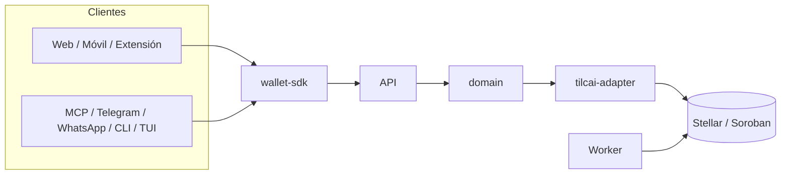

# TilcAI Wallet

> **Tarjetas de gasto para agentes de IA.** Fondeas una sesión, el agente compra dentro de los límites, tú controlas todo desde el celular y cada compra deja un recibo verificable en Stellar.

**Para quién:** agencias de automatización con IA en La Paz, Bolivia, y freelancers que operan agentes para clientes. **Modelo:** suscripción mensual por agencia.

**Estado:** la base del monorepo está lista y compila. Las cuentas, compras y límites se construyen ahora sobre **Stellar testnet**. Revisa el [checklist](#checklist-del-equipo).

---

## Empieza en 3 pasos

Necesitas **Node.js 24.22.1** (ver `.node-version`) y **pnpm 10.33.0**. Para los contratos, también **Rust** y **Stellar CLI**.

```sh
# 1. Instalar todo el workspace
pnpm install --frozen-lockfile

# 2. Comprobar que todo compila y pasa las pruebas
pnpm check

# 3. Levantar la API y la web (cada una en su terminal)
pnpm --filter @tilcai-wallet/api dev     # http://127.0.0.1:4000/healthz
pnpm --filter @tilcai-wallet/web dev     # http://localhost:3000
```

No necesitas un archivo `.env` para trabajar en local: cada variable tiene un valor por defecto. [`.env.example`](.env.example) muestra cuáles existen.

---

## Cómo encaja todo



**Regla de oro:** los clientes solo hablan con la API a través de `wallet-sdk`. Nunca importan firmantes, credenciales ni acceso directo a datos. Más detalle en [Arquitectura](docs/architecture.md).

---

## ¿Qué módulo toco?

Todos los comandos se ejecutan **desde la raíz** del repo.

### Clientes (lo que ve el usuario o el agente)

| Módulo | Para qué sirve | Comando | Stack |
| --- | --- | --- | --- |
| [Landing](apps/landing/README.md) | Página pública del proyecto | `pnpm --filter @tilcai-wallet/landing dev` | Next.js 16.4 estático |
| [Web](apps/web/README.md) | Panel del dueño (PWA) | `pnpm --filter @tilcai-wallet/web dev` | Next.js 16.4 + Tailwind 4 |
| [Móvil](apps/mobile/README.md) | App iOS/Android | `pnpm --filter @tilcai-wallet/mobile dev` | Expo 58 + React Native 0.88 |
| [Extensión](apps/extension/README.md) | Wallet en el navegador | `pnpm --filter @tilcai-wallet/extension dev` | WXT + Manifest V3 |
| [MCP](apps/mcp/README.md) | Herramientas para agentes de IA | `pnpm --filter @tilcai-wallet/mcp start` | MCP SDK v2 (stdio) |
| [Bot de Telegram](apps/telegram-bot/README.md) | Avisos y vínculo por chat | `pnpm --filter @tilcai-wallet/telegram-bot check` | grammY |
| [Mini App de Telegram](apps/telegram-miniapp/README.md) | Panel dentro de Telegram | `pnpm --filter @tilcai-wallet/telegram-miniapp dev` | React + Vite |
| [CLI](apps/cli/README.md) | Consultas desde la terminal | `pnpm --filter @tilcai-wallet/cli start --help` | Commander |
| [TUI](apps/tui/README.md) | Vista interactiva en terminal | `pnpm --filter @tilcai-wallet/tui start` | Ink |

### Servicios (backend)

| Módulo | Para qué sirve | Comando | Puerto |
| --- | --- | --- | --- |
| [API](services/api/README.md) | Gateway: sesiones, tarjetas, órdenes | `pnpm --filter @tilcai-wallet/api dev` | 4000 |
| [Worker](services/worker/README.md) | Conciliación con Stellar | `pnpm --filter @tilcai-wallet/worker check` | — |
| [WhatsApp](services/whatsapp/README.md) | Webhooks y avisos | `pnpm --filter @tilcai-wallet/whatsapp dev` | 4001 |

### Paquetes compartidos

| Paquete | Úsalo para |
| --- | --- |
| `packages/api-contracts` | Esquemas Zod de cada endpoint. **Empieza aquí** si agregas una ruta. |
| `packages/wallet-sdk` | Cliente HTTP que usan todos los canales. |
| `packages/domain` | Reglas de negocio y estados (tarjeta, orden). Sin red ni base de datos. |
| `packages/tilcai-adapter` | Puente hacia Stellar y la infraestructura TilcAI. |
| `packages/config` | Nombre, versión, URL local y paleta de colores. |

### Contratos

| Módulo | Comando |
| --- | --- |
| [Soroban](contracts/soroban/README.md) | `cd contracts/soroban && cargo test --workspace --lib --locked` |

---

## Cómo contribuir

1. Elige una tarea del checklist y crea una rama desde `main`.
2. Trabaja solo en tu módulo con `pnpm --filter @tilcai-wallet/<módulo> …`.
3. Ejecuta `pnpm check` antes de subir.
4. Abre un PR. CI corre el workspace y los contratos.

¿Cambias un endpoint? Primero `api-contracts`, luego la API, luego el SDK y al final el cliente. Guía completa en [CONTRIBUTING](CONTRIBUTING.md).

---

## Checklist del equipo

<details open>
<summary><b>0. Base de desarrollo</b> · 3/4</summary>

- [x] Crear workspace pnpm con dependencias fijadas y un único lockfile JavaScript.
- [x] Preparar apps, adaptadores, API, worker, paquetes, Rust, comandos por módulo y CI.
- [x] Agregar pruebas de humo de salud y MCP, y un test del contrato base.
- [ ] Definir entornos, credenciales de testnet, activos y responsables mediante PR.

</details>

<details>
<summary><b>1. Autoridad, API y estado</b> · 0/6</summary>

- [ ] Modelar usuarios, tenants, sesiones lógicas, credenciales, tarjetas, políticas y recuperaciones.
- [ ] Implementar alta, respaldo, WebAuthn, scopes, cierre y rotación.
- [ ] Implementar intención de vínculo y fondeo con enlace de uso único.
- [ ] Persistir órdenes, intentos, idempotencia, retenciones y outbox.
- [ ] Versionar contratos de API, permitir consultas por alcance y proyectar el estado confirmado.
- [ ] Aislar el firmante delegado y medir despliegue y restauración de subcuentas.

</details>

<details>
<summary><b>2. Compra directa y recibo</b> · 0/6</summary>

- [ ] Confirmar la cuenta de contrato, factory, activo de prueba y proveedor.
- [ ] Limitar activo, destino, monto, vigencia y gasto acumulado. Probar el rechazo directo en Soroban.
- [ ] Implementar cotización, simulación, firma aislada, envío y conciliación por hash.
- [ ] Conservar el pedido ante resultado incierto, cotización vencida o rechazo de presupuesto.
- [ ] Registrar evidencia autenticada de entrega y emitir un recibo con ID estable.
- [ ] Reconciliar eventos, cursor, entrega tardía, duplicados y costo de las transacciones.

</details>

<details>
<summary><b>3. Primera integración: web, móvil y MCP</b> · 0/5</summary>

- [ ] Mostrar saldo distinguido del disponible, centro de sesiones, tarjetas y extracto.
- [ ] Implementar herramientas para consultar presupuesto, pedir una compra, solicitar aumento y buscar recibo.
- [ ] Aprobar el aumento con passkey y retomar la misma orden tras confirmar y revalidar.
- [ ] Congelar, reactivar, revocar y devolver remanente con estados de confirmación.
- [ ] Reproducir los dos pagos y los rechazos del [guion de demo](docs/demo.md).

</details>

<details>
<summary><b>4. Canales adicionales</b> · 0/6</summary>

- [ ] **Móvil.** Confirmar compilaciones iOS/Android, enlaces verificados, passkeys y notificaciones.
- [ ] **Extensión.** Revisar permisos por origen, mensajes, expiración, revocación y Chrome/Edge.
- [ ] **MCP remoto.** Integrar Streamable HTTP y validar autenticación, scopes y cada cliente.
- [ ] **Telegram.** Validar bot y Mini App, vínculo, avisos y retorno al panel seguro.
- [ ] **WhatsApp.** Verificar compatibilidad del caso con Meta, plantillas y webhooks.
- [ ] **CLI/TUI.** Añadir alta autorizada, estado de sesión, consultas y recibos.

</details>

<details>
<summary><b>5. Pruebas operativas y piloto</b> · 0/5</summary>

- [ ] Probar aislamiento de tenants, dos tarjetas independientes y rotación sin reiniciar gasto.
- [ ] Probar límites, revocación, resultados ambiguos, protección contra duplicados y retorno de fondos.
- [ ] Evaluar x402 y MPP con la smart account y capacidades de fondeo mediante rutas validadas.
- [ ] Medir costo, tiempo de conciliación, disponibilidad y disposición a pagar con agencias y freelancers.
- [ ] Registrar demo, hashes, resultados y estado por canal antes de publicar la postulación.

</details>

---

## Documentación

| Tema | Documento |
| --- | --- |
| Qué resuelve y ejemplo de uso | [Producto](docs/product.md) |
| Capas y límites de cada módulo | [Arquitectura](docs/architecture.md) |
| Versiones y fuentes oficiales | [Stack](docs/stack.md) |
| Órdenes, intentos y conciliación | [Persistencia](docs/persistence.md) |
| Por qué bot y MCP propios | [ADR 001](docs/adr/001-owned-channels.md) |
| Herramientas y riel de pago de la demo | [ADR 002](docs/adr/002-toolchain-and-demo.md) |
| Paso a paso de la demo | [Guion de demo](docs/demo.md) |

[Organización en GitHub](https://github.com/TilcAI-Wallet)
