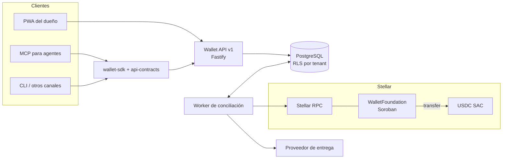

# TilcAI Wallet

**Infraestructura de pagos autorizados para agentes de IA sobre Stellar.**

TilcAI Wallet permite que un agente de IA compre en nombre de una persona o una organización. El agente nunca recibe acceso libre a los fondos: opera con una tarjeta de gasto que tiene presupuesto propio, límites por pago y por total, un destinatario fijado y un recibo verificable por cada orden.

La autoridad final sobre el gasto reside en un contrato **Soroban**. Una **API** multi-tenant coordina órdenes e idempotencia. Un **worker** concilia cada pago contra la red **Stellar**. Las aplicaciones y los agentes se integran mediante un **SDK** tipado y un servidor **MCP**.

> Pensado para agencias de automatización con IA y profesionales que operan agentes para sus clientes, empezando por La Paz, Bolivia.

---

## ¿Qué resuelve?

| Necesidad | Cómo la aborda TilcAI Wallet |
| --- | --- |
| **Autorizar pagos ejecutados por agentes** | El agente firma solo la operación de gasto de su tarjeta. El contrato decide si el pago respeta la política. |
| **Controlar presupuestos y políticas** | Cada tarjeta fija el activo, el destinatario, el máximo por pago, el límite acumulado y la congelación. Antes de aceptar una orden, la API retiene el importe contra el saldo y la capacidad disponibles. |
| **Trazar órdenes, transacciones y recibos** | Cada compra tiene una orden, un intento de pago, un hash de transacción y un recibo con ID estable. El recibo separa pago, entrega y reembolso. |
| **Integrarse de forma programática** | Contratos de API versionados con Zod y OpenAPI, un cliente TypeScript compartido y herramientas MCP para agentes. |

---

## Funcionalidades

### WalletFoundation: política de gasto en Soroban
- Contrato de custodia en Rust (Soroban SDK 29) que retiene fondos y solo transfiere el activo configurado al destinatario configurado.
- `spend` exige la firma del agente y aplica el máximo por pago y el límite acumulado. El contador y la transferencia se revierten juntos si algo falla.
- El dueño gestiona la política con `set_policy`: rota el agente sin reiniciar el gasto, congela la tarjeta y ajusta los límites. Recupera fondos con `withdraw`.
- Desplegado en Stellar Testnet con USDC: allí se confirmó un pago de 0,50 USDC y la red rechazó un gasto que superaba el límite ([evidencia](contracts/soroban/README.md#evidencia-de-testnet--issue-5)).

### API de órdenes y recibos (v1)
- Servicio Fastify con rutas para sesión, tarjeta, creación y consulta de órdenes, y recibos.
- Autenticación con token bearer. La base de datos solo guarda el hash SHA-256 del token. Cada ruta exige un scope (`sessions:read`, `cards:read`, `orders:write`, `orders:read`, `receipts:read`).
- El tenant se obtiene siempre de la credencial verificada, nunca de cabeceras, del cuerpo ni de la ruta.
- Esquemas compartidos en `packages/api-contracts`, que también genera la especificación OpenAPI.

### Idempotencia y control transaccional
- `POST /v1/orders` requiere una `Idempotency-Key`. Repetir la misma solicitud devuelve la misma orden. Reusar la clave con otro contenido devuelve `409`.
- La orden, la retención de presupuesto, el intento de pago, el evento de outbox y el recibo se crean en una sola transacción, con bloqueo de la tarjeta para evitar sobregasto concurrente.
- Cada orden tiene como máximo un intento de pago activo, y un mismo hash de transacción solo puede liquidar una orden.

### Worker de conciliación
- Reclama trabajo con leases y fencing (`SKIP LOCKED` y tokens de lease). Todas las transiciones se ejecutan en funciones SQL que verifican el lease vigente.
- Prepara y firma cada pago **una sola vez** y guarda el sobre XDR cifrado con AES-256-GCM. La clave se mantiene fuera de la base de datos. Tras un reinicio recupera el mismo sobre y el mismo hash.
- Para confirmar un pago verifica la transacción y el evento de transferencia SEP-41: hash, red, sobre, activo, origen, destinatario, importe y rango de ledgers. Un timeout, un `NOT_FOUND` o una evidencia que no coincide conservan la orden y la retención sin generar un nuevo cargo.
- Cada llamada RPC tiene un plazo máximo.
- Después de un pago confirmado, el proveedor de entrega de referencia (`demo-report-provider`) emite un artefacto. El worker verifica de forma independiente su digest y su vínculo con la orden antes de registrar la entrega.

### PostgreSQL, RLS y aislamiento multi-tenant
- Esquema privado con migraciones numeradas, aplicadas con bloqueo y verificación de checksum.
- Row-Level Security forzada en todas las tablas de tenant.
- Para el rol de la API, el tenant queda vinculado a la credencial verificada en la misma transacción, así que cambiar el contexto de sesión no da acceso a otro tenant.
- Roles separados (`wallet_migrator`, `wallet_api`, `wallet_worker`), sin `BYPASSRLS` ni privilegios de superusuario. El worker no tiene DML directo: actúa solo mediante funciones `SECURITY DEFINER` con `search_path` fijado.
- La evidencia de pago y de entrega solo se escribe mediante transiciones verificadas, nunca con DML de los servicios.

### SDK, MCP y aplicaciones cliente
- **`wallet-sdk`:** cliente HTTP tipado que valida cada respuesta con los esquemas de la API.
- **MCP (stdio):** herramientas `get_card`, `create_order`, `get_order` y `get_receipt` para que un agente consulte su presupuesto, compre y lea su recibo.
- **PWA (Next.js):** panel del dueño. Cuando está configurada la API, el recibo se lee desde la API v1.
- El mismo `receiptId` se lee igual desde la API, el MCP y la PWA; una prueba de integración lo comprueba.
- Bases de canal adicionales en el monorepo: app móvil (Expo), extensión de navegador (WXT), bot y Mini App de Telegram, CLI, TUI y servicio de webhooks de WhatsApp.

### Seguridad y separación de responsabilidades
- Los clientes nunca importan firmantes, credenciales ni acceso a datos: hablan con la API.
- La firma del agente, la clave de cifrado de sobres y las credenciales de base de datos se inyectan desde archivos o almacenes externos con permisos restringidos.
- La difusión de transacciones está protegida por una compuerta explícita en el código, cerrada por defecto.

---

## Arquitectura



**Flujo de una compra:**
1. El agente pide una orden con una clave de idempotencia.
2. La API valida la credencial, el scope y el presupuesto, retiene el importe y registra la orden y el evento de pago.
3. El worker reclama el evento, prepara y firma un único sobre, y lo guarda cifrado.
4. El worker concilia por hash contra Stellar. Con evidencia verificada confirma el pago, libera la retención, actualiza el gasto y dispara la entrega.
5. El recibo refleja el pago, la entrega y el reembolso por separado.

Más detalle en [Arquitectura](docs/architecture.md) y [Persistencia](docs/persistence.md).

---

## Tecnologías

| Capa | Tecnología |
| --- | --- |
| Contratos | Rust, Soroban SDK 29, Stellar CLI |
| Red | Stellar Testnet, USDC (Stellar Asset Contract), `@stellar/stellar-sdk` 17 |
| Backend | Node.js 24, TypeScript, Fastify 5, Zod 4, `pg` |
| Datos | PostgreSQL 17 con Row-Level Security (Supabase Postgres como destino gestionado) |
| Agentes | Model Context Protocol (`@modelcontextprotocol/server`, stdio) |
| Clientes | Next.js 16 + Tailwind 4, Expo + React Native, WXT, Vite + React, grammY, Commander, Ink |
| Herramientas | pnpm 10 (workspace y catálogo), tsx, `node:test`, GitHub Actions |

---

## Estructura del monorepo

| Carpeta | Contenido |
| --- | --- |
| `contracts/soroban` | Contrato `WalletFoundation` y sus pruebas. |
| `services/api` | Wallet API v1: autenticación, órdenes, idempotencia y recibos. |
| `services/worker` | Conciliación con Stellar, sobres cifrados, leases y entrega. |
| `services/whatsapp` | Frontera de webhooks y avisos. |
| `infra/postgres` | Roles, migraciones, script de migración y pruebas de aislamiento. |
| `packages/api-contracts` | Esquemas Zod de cada endpoint y generación de OpenAPI. |
| `packages/wallet-sdk` | Cliente HTTP compartido por los canales. |
| `packages/domain` | Estados y reglas de negocio, sin red ni base de datos. |
| `packages/tilcai-adapter` | Puente hacia Stellar. |
| `packages/config` | Nombre, versión, URL local y paleta. |
| `apps/*` | PWA (`web`), `mcp`, `mobile`, `extension`, `telegram-bot`, `telegram-miniapp`, `cli`, `tui` y `landing`. |
| `tests` | Pruebas de humo del workspace (MCP). |
| `docs` | Producto, arquitectura, decisiones (ADR), validación e investigación. |

---

## Instalación y desarrollo

**Requisitos:** Node.js 24.22.1 (ver [`.node-version`](.node-version)) y pnpm 10.33.0. Para los contratos también necesitas Rust (versión fijada en `contracts/soroban/rust-toolchain.toml`) y Stellar CLI.

```sh
# Instalar el workspace con el lockfile fijado
pnpm install --frozen-lockfile

# Lint, typecheck, pruebas y build de todo el workspace
pnpm check

# API (http://127.0.0.1:4000/healthz) y PWA (http://localhost:3000), cada una en su terminal
pnpm --filter @tilcai-wallet/api dev
pnpm --filter @tilcai-wallet/web dev

# Validar la configuración del worker
pnpm --filter @tilcai-wallet/worker check

# Servidor MCP por stdio (requiere WALLET_API_URL, WALLET_MCP_TOKEN y WALLET_MCP_CARD_ID)
pnpm --filter @tilcai-wallet/mcp start

# Contratos
cd contracts/soroban && cargo test --workspace --lib --locked
```

**Base de datos.** La API usa PostgreSQL cuando se define `WALLET_API_DATABASE_URL`; en hosts remotos exige TLS con `sslmode=verify-full`.
- Un administrador crea los roles con `infra/postgres/bootstrap-roles.sql`.
- Las migraciones se aplican con `WALLET_MIGRATION_DATABASE_URL=... bash infra/postgres/migrate.sh`.
- Para una base PostgreSQL 17 **desechable**, `WALLET_TEST_DATABASE_URL=... bash infra/postgres/test-db.sh` aplica las migraciones y ejecuta las pruebas de aislamiento.

Detalles en [infra/postgres](infra/postgres/README.md). Las variables disponibles están en [`.env.example`](.env.example) y los modos del worker en [services/worker](services/worker/README.md).

---

## Seguridad

TilcAI Wallet aplica defensa en profundidad. Ninguna capa se considera suficiente por sí sola:

- **Cadena:** el contrato limita activo, destinatario, máximo por pago y gasto acumulado, independientemente de lo que pida el agente.
- **Datos:** RLS forzada, tenant vinculado a la credencial verificada, roles mínimos sin `BYPASSRLS` y funciones `SECURITY DEFINER` con `search_path` fijado y sin ejecución para `PUBLIC`.
- **Pagos:** idempotencia por clave y contenido, retención previa de presupuesto, un intento activo por orden, fencing por lease y confirmación únicamente con evidencia verificada. Ante cualquier incertidumbre, la orden queda pendiente y no se genera un cargo nuevo.
- **Secretos:** firmante del agente y clave AEAD fuera del repositorio y de la base de datos, con verificación de permisos de archivo. Los tokens se guardan solo como hash.
- **Verificación continua:** cada PR ejecuta en CI las pruebas del workspace, los contratos y las pruebas de integración contra PostgreSQL 17. Estas incluyen aislamiento entre tenants, permisos, concurrencia, reinicios y evidencia manipulada.

Los riesgos conocidos y sus mitigaciones están documentados en [infra/postgres](infra/postgres/README.md), [services/worker](services/worker/README.md) y [Preflight Testnet](docs/testnet-preflight.md).

---

## Estado de integración

| Módulo | Estado |
| --- | --- |
| Contrato `WalletFoundation` en Testnet | Desplegado; pago de 0,50 USDC y rechazo por límite verificados en red (issue #5). |
| API v1, idempotencia y recibos | Implementados; validados con PostgreSQL 17 en CI. |
| RLS, roles y aislamiento multi-tenant | Implementados; validados con PostgreSQL 17 en CI. |
| Worker: firma única, sobre cifrado, conciliación y entrega | Implementados; validados en CI con respuestas RPC controladas. |
| Lectura del mismo recibo desde la API, el MCP y la PWA | Implementada; validada en CI. |
| Canales móvil, extensión, Telegram, WhatsApp, CLI y TUI | Base disponible; conexión completa con la API v1 en curso. |
| **Pagos reales en Stellar Testnet desde el backend** | **Pendientes de activación.** |

La difusión de transacciones desde el worker sigue deshabilitada a propósito. Antes de activarla, el contrato debe vincular el destinatario a la operación que firma el agente: hoy `spend(amount)` toma el destinatario de la política, que el dueño puede cambiar. Después hará falta infraestructura dedicada (RPC, base de datos privada, firmante aislado y una instancia fondeada) y una autorización expresa.

Hasta entonces, ningún recibo del backend corresponde a una liquidación en Stellar. Que el CI pase valida la lógica, no una liquidación real. El pago verificado en Testnet se ejecutó directamente contra el contrato, no a través del backend. [Preflight y pasos de activación](docs/testnet-preflight.md)

---

## Contribución y documentación

1. Crea una rama desde `main` y trabaja en tu módulo con `pnpm --filter @tilcai-wallet/<módulo> …`.
2. Si cambias un endpoint, modifica en orden `api-contracts`, la API, el SDK y por último el cliente.
3. Ejecuta las pruebas de tu módulo y abre un PR: el CI ejecuta el workspace, los contratos y PostgreSQL.

Guía completa en [CONTRIBUTING](CONTRIBUTING.md).

| Tema | Documento |
| --- | --- |
| Producto y casos de uso | [Producto](docs/product.md) |
| Prioridades y dependencias | [Roadmap](docs/roadmap.md) |
| Capas y límites de cada módulo | [Arquitectura](docs/architecture.md) |
| Versiones y fuentes oficiales | [Stack](docs/stack.md) |
| Órdenes, intentos y conciliación | [Persistencia](docs/persistence.md) |
| Pruebas y evidencias por fase | [Validación](docs/validation.md) |
| Esquemas de la API v1 y entorno de referencia | [API v1](docs/demo-api.md) |
| Guion de presentación | [Guion](docs/demo.md) |
| Activación de pagos Testnet | [Preflight Testnet](docs/testnet-preflight.md) |
| Contrato y evidencia en Testnet | [Soroban](contracts/soroban/README.md) |
| Base de datos y roles | [infra/postgres](infra/postgres/README.md) |
| Worker y modos de ejecución | [services/worker](services/worker/README.md) |
| Decisiones de arquitectura | [ADR 001](docs/adr/001-owned-channels.md) · [ADR 002](docs/adr/002-toolchain-and-demo.md) · [ADR 003](docs/adr/003-supabase-persistence.md) |
| Autorización poscuántica (línea de investigación) | [Investigación](docs/research/post-quantum.md) |

[Organización en GitHub](https://github.com/TilcAI-Wallet)
